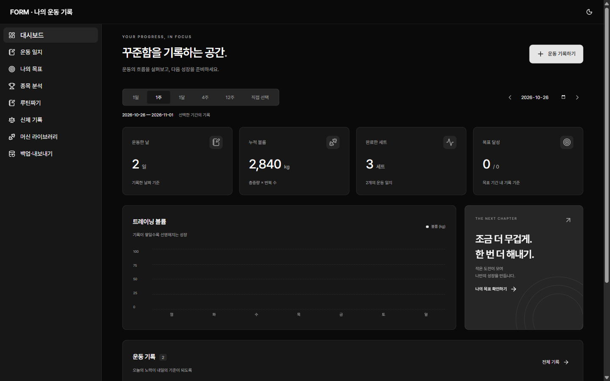
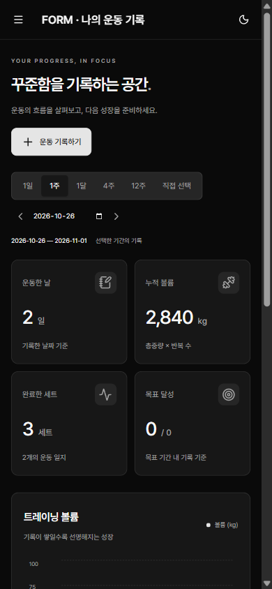
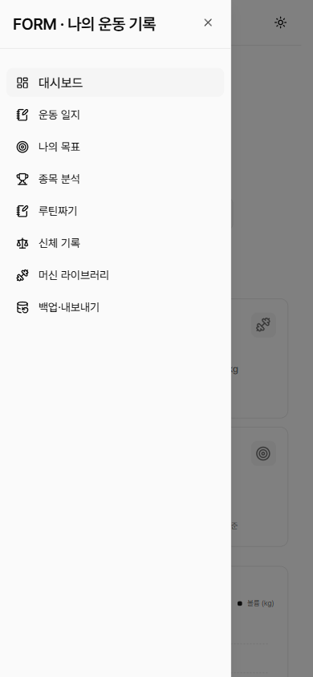

# #159 공통 디자인 시스템으로 화면 전환

- 이슈: [#159](https://github.com/sirloinbh/workout-memo/issues/159) (중앙 추적 이슈 sirloinbh/project-standards#126)
- 브랜치: `feat/159-design-system`

## 목적

8개 앱이 같은 토큰·컴포넌트·레이아웃·PWA 설정을 쓰기로 했다(중앙 ADR-0007, ADR-0008). workout-memo가 첫 적용 앱이다.

## 변경 — 2026-10-26

### 패키지

#126 범위로 사용자가 사전 승인한 패키지를 사용자가 직접 설치했다(중앙 ADR-0007 표의 고정 버전, 게시 14일 경과, `--ignore-scripts`). 설치 전에 `npm view`로 게시일과 설치 스크립트가 없음을 확인했다.

- 추가: `radix-ui` 1.7.0(하위 `@radix-ui/*` 60개), `sonner` 2.0.8, `vaul` 1.1.2, `tw-animate-css` 1.4.0, `@sirloinbh/design-tokens` 1.0.0
- 변경: `lucide-react` 0.468.0 → 1.52.0. 쓰던 아이콘 이름은 그대로 동작한다.
- lockfile 두 개(루트, `frontend/`)에서 지워지거나 바뀐 다른 패키지는 없다. 새 항목은 모두 `registry.npmjs.org` 또는 `npm.pkg.github.com`에서 오고 무결성 값이 있으며 설치 스크립트가 없다. `ioc-scan`: 의심 항목 없음.

### 공통 파일 (중앙 관리)

중앙에서 workout-memo의 `features.ui`를 켠 동기화 미리보기(`sync.mjs --dry-run --local`)에서 뽑은 파일을 그대로 넣었다. 이후 동기화 PR과 내용이 같다.

- `frontend/src/components/ui/` 공통 컴포넌트 15개와 테스트(기존 `button.tsx`·`dialog.tsx`는 공통 컴포넌트로 바뀜)
- `frontend/src/components/layout/`(`AppShell`, 화면 모드 메뉴), `frontend/src/lib/utils.ts`·`theme.ts`, `frontend/public/theme-init.js`

### 앱 코드

- **셸:** 자체 사이드바·헤더·footer를 `AppShell`로 바꿨다. 메뉴 이름은 '주 메뉴'다. 768px 미만에서는 상단 바의 "메뉴 열기"가 왼쪽 Sheet로 메뉴를 연다. 기간을 공유하는 페이지(대시보드·일지·신체 기록)의 메뉴 링크는 지금 고른 기간 주소를 유지한다(#85).
- **모달:** `components/modal.tsx`의 `Modal`이 공통 Dialog를 연다. 모달이 열려 있으면 뒤쪽 화면은 화면 읽기 프로그램과 클릭에서 모두 막힌다. 일지 저장 중에는 원래부터 모달을 닫을 수 없으므로(`setEditor`), 저장 중에 기간을 바꾸는 경쟁은 이제 삭제에서만 생긴다. `period.test.tsx`를 이에 맞게 나눴다.
- **버튼:** `Button` 6곳을 공통 `Button` 변형(`default`, `secondary`, `ghost`, `w-full`)으로 바꿨다. 나머지 `<button>`은 기존 클래스 그대로다.
- `components/ui/field.tsx` → `components/field.tsx`(중앙 관리 폴더 밖으로), `lib/cn.ts` 삭제(`lib/utils.ts`의 `cn`).

### 스타일

- `theme.css`를 지우고 `index.css`에서 Tailwind CSS 4(Preflight 포함), `tw-animate-css`, 공통 토큰을 불러온다. 글꼴은 Google Fonts(DM Sans, Noto Sans KR) 대신 토큰의 Pretendard다.
- `style.css`(1,500줄 → 약 1,230줄)는 `components` 레이어로 불러온다. 일회성 변환 스크립트로 다음을 했다.
  - 셸 규칙(사이드바, 헤더, 로고, 프로필, footer, 모달 배경·틀)을 지웠다.
  - 요소 규칙(`button`, `p`, `h1` 등)은 `:where(.legacy)` 안에서만 적용되게 했다. 페이지 본문과 모달 내용이 `.legacy`다.
  - 예전 토큰 변수는 중앙 `docs/design-tokens.md` 대응표대로 새 토큰으로, 직접 쓴 초록 계열 색 88곳은 속성과 밝기에 따라 `--foreground`·`--muted-foreground`·`--muted`·`--card`·`--border`·`--primary`로 바꿨다. 목표 배지는 `--warning`·`--success`를 쓴다.
- 회색 바탕(`--muted`) 위 흐린 글자는 라이트 모드에서 4.35:1이라, 그런 바탕 11곳의 글자는 전경색을 더 섞었다(`style.css` 끝).

### PWA

- 아이콘 4개(중앙 `scripts/pwa-icons.mjs`, 공통 임시 아이콘), `index.html`의 manifest·아이콘·라이트/다크 `theme-color`·`viewport-fit=cover`, 깜빡임 방지 스크립트
- `main.tsx`가 운영 빌드에서만 서비스 워커(`/sw.js`, 이미 중앙 동기화됨)를 등록한다.

### 테스트

- 메뉴 이름 '주요 메뉴' → '주 메뉴'(단위 테스트 2곳, e2e 3곳). e2e `layout.spec.ts`는 휴대폰 폭에서 메뉴를 열고 링크를 확인한다.
- `a11y-known-contrast.json`: 예전 초록 계열 색 조합이 모두 사라져 비웠다.
- 화면 비교 기준 이미지 44장(`e2e/__screenshots__/ui-visual.spec.ts/`)은 CI(e2e-visual)가 만든 후보(`visual-baselines`)를 확인한 뒤 교체했다. 같은 고정 데이터라 전후 비교가 된다.
- `support/ui-fixtures.ts`의 `settle`은 끝이 있는 애니메이션이 모두 끝날 때까지 기다린다. 모달이 반투명하게 나타나는 중간에 axe가 뒤 화면 색을 섞어 읽어 대비가 4.28:1로 잘못 나왔다.

## 검증

- 프론트엔드 단위 테스트: 35개 파일, 155개 통과. `tsc`(전체·빌드 설정), `vite build`, Prettier 통과
- 실제 Chrome(운영 빌드, 가짜 API)에서 확인:
  - 390·1440px, 라이트·다크 화면. 390px 가로 넘침 없음, 메뉴 Sheet와 모달 동작
  - 텍스트 대비(WCAG AA): 8개 페이지와 모달 3개 × 390·1280px × 라이트·다크에서 기준 미달 0건
- CI: `verify`(형식·린트·계약·타입·단위 테스트·문서·빌드), `docker-build`, `e2e-visual`(e2e 26개, 화면 비교 44장)
  - 처음 실행에서 화면 비교 외에 실패한 것: 휴대폰 폭 메뉴 링크 위치(Sheet가 미끄러져 들어오는 중에 측정), 목표 달성 배지 대비 4.01:1, 목표 모달 대비(위 애니메이션 문제). 모두 고쳤다.

## 다크 모드 화면

화면 비교 기준 이미지는 라이트 모드뿐이라, 다크 모드는 운영 빌드에 가짜 API를 붙여 찍었다(데이터가 기준 이미지와 다르다).

| 1440px 다크                                             | 390px 다크                                            | 390px 메뉴                                        |
| ------------------------------------------------------- | ----------------------------------------------------- | ------------------------------------------------- |
|  |  |  |
