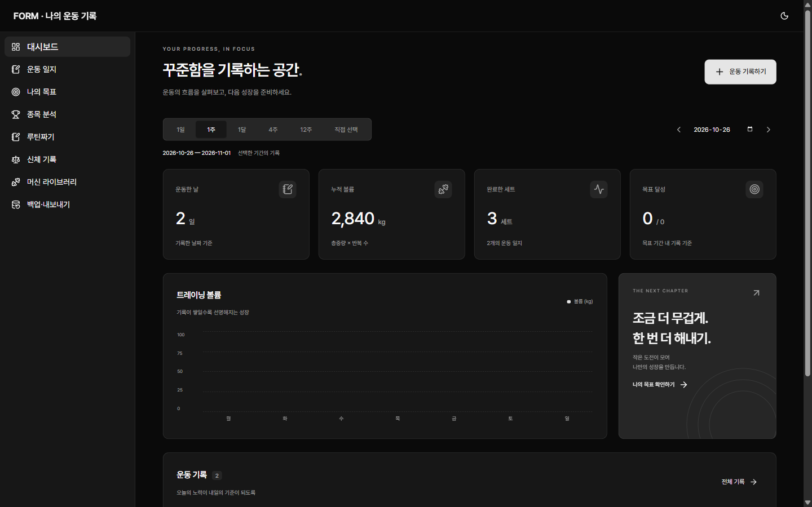
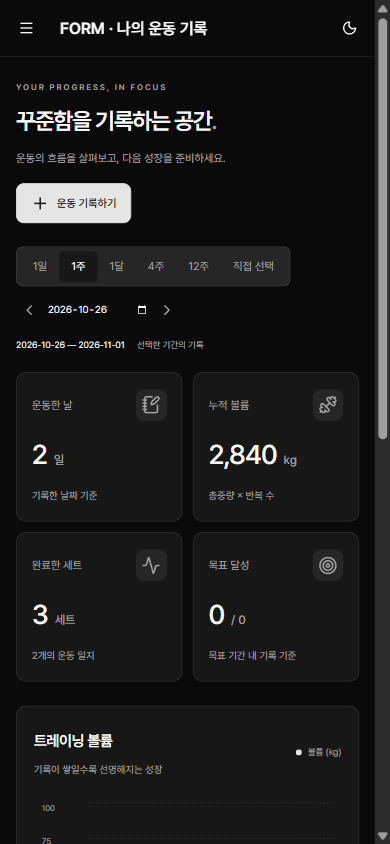
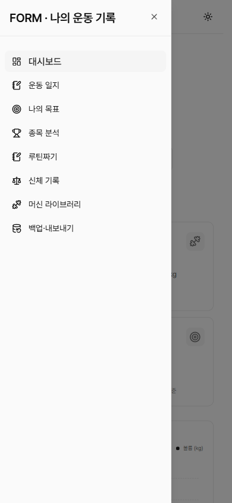

# #159 Switch the screens to the shared design system

- Issue: [#159](https://github.com/sirloinbh/workout-memo/issues/159) (central tracking issue sirloinbh/project-standards#126)
- Branch: `feat/159-design-system`

## Purpose

The 8 apps decided to use the same tokens, components, layout, and PWA settings (central ADR-0007, ADR-0008). workout-memo is the first app to apply them.

## Change — 2026-10-26

### Packages

The user installed the packages that the user had approved in advance for the scope of #126 directly (the fixed versions in the central ADR-0007 table, published more than 14 days ago, `--ignore-scripts`). Before installing, I checked the publish dates and that there are no install scripts with `npm view`.

- Added: `radix-ui` 1.7.0 (60 sub-packages `@radix-ui/*`), `sonner` 2.0.8, `vaul` 1.1.2, `tw-animate-css` 1.4.0, `@sirloinbh/design-tokens` 1.0.0
- Changed: `lucide-react` 0.468.0 → 1.52.0. The icon names in use still work.
- No other package was removed or changed in the two lockfiles (root and `frontend/`). All new entries come from `registry.npmjs.org` or `npm.pkg.github.com`, have integrity values, and have no install scripts. `ioc-scan`: no suspicious item.

### Shared files (centrally managed)

I put in as they are the files taken from the sync preview (`sync.mjs --dry-run --local`) with `features.ui` of workout-memo turned on in the central repo. They have the same content as the later sync PR.

- 15 shared components in `frontend/src/components/ui/` and their tests (the existing `button.tsx` and `dialog.tsx` became shared components)
- `frontend/src/components/layout/` (`AppShell`, the screen mode menu), `frontend/src/lib/utils.ts` and `theme.ts`, `frontend/public/theme-init.js`

### App code

- **Shell:** replaced the own sidebar, header, and footer with `AppShell`. The menu name is '주 메뉴' (main menu). Below 768px, "메뉴 열기" (open menu) in the top bar opens the menu in a left Sheet. The menu links of the pages that share the range (dashboard, log, body records) keep the URL of the currently chosen range (#85).
- **Modal:** `Modal` in `components/modal.tsx` opens the shared Dialog. While a modal is open, the screen behind it is blocked from both screen readers and clicks. A log modal cannot be closed while saving to begin with (`setEditor`), so the race of changing the range while saving now happens only with delete. I split `period.test.tsx` to match this.
- **Button:** replaced 6 `Button` places with the shared `Button` variants (`default`, `secondary`, `ghost`, `w-full`). The other `<button>` elements keep their existing classes.
- `components/ui/field.tsx` → `components/field.tsx` (out of the centrally managed folder), `lib/cn.ts` deleted (`cn` in `lib/utils.ts`).

### Styles

- Deleted `theme.css`, and `index.css` loads Tailwind CSS 4 (including Preflight), `tw-animate-css`, and the shared tokens. The font is Pretendard from the tokens instead of Google Fonts (DM Sans, Noto Sans KR).
- `style.css` (1,500 lines → about 1,230 lines) is loaded in the `components` layer. With a one-off conversion script I did the following.
  - Deleted the shell rules (sidebar, header, logo, profile, footer, modal background and frame).
  - Made element rules (`button`, `p`, `h1`, and so on) apply only inside `:where(.legacy)`. The page body and the modal content are `.legacy`.
  - Old token variables were changed to the new tokens as in the central `docs/design-tokens.md` mapping table, and the 88 places with directly written green colors were changed to `--foreground`, `--muted-foreground`, `--muted`, `--card`, `--border`, and `--primary` depending on the property and brightness. The goal badge uses `--warning` and `--success`.
- Faint text on a gray background (`--muted`) is 4.35:1 in light mode, so for the text on those 11 backgrounds I mixed in more of the foreground color (end of `style.css`).

### PWA

- 4 icons (central `scripts/pwa-icons.mjs`, shared temporary icons), manifest, icons, light/dark `theme-color`, and `viewport-fit=cover` in `index.html`, and a script that prevents flicker
- `main.tsx` registers the service worker (`/sw.js`, already synced from the central repo) only in the production build.

### Tests

- Menu name '주요 메뉴' → '주 메뉴' (2 places in unit tests, 3 places in e2e). e2e `layout.spec.ts` opens the menu at phone width and checks the links.
- `a11y-known-contrast.json`: emptied because all the old green color pairs disappeared.
- The 44 screen comparison baseline images (`e2e/__screenshots__/ui-visual.spec.ts/`) were replaced after checking the candidates (`visual-baselines`) that CI (e2e-visual) made. They use the same fixed data, so before and after can be compared.
- `settle` in `support/ui-fixtures.ts` waits until all animations that have an end are finished. While a modal was appearing semi-transparently, axe read the colors of the screen behind it mixed in, and the contrast came out wrongly as 4.28:1.

## Verification

- Frontend unit tests: 35 files, 155 passed. `tsc` (whole and build config), `vite build`, and Prettier passed
- Checked in real Chrome (production build, fake API):
  - 390 and 1440px, light and dark screens. No horizontal overflow at 390px, and the menu Sheet and the modal work
  - Text contrast (WCAG AA): on 8 pages and 3 modals × 390 and 1280px × light and dark, 0 below the criterion
- CI: `verify` (format, lint, contract, type, unit tests, docs, build), `docker-build`, `e2e-visual` (26 e2e tests, 44 screen comparisons)
  - Failures other than the screen comparison in the first run: the position of the menu link at phone width (measured while the Sheet was sliding in), the goal achievement badge contrast 4.01:1, and the goal modal contrast (the animation problem above). All were fixed.

## Dark mode screens

The screen comparison baselines are light mode only, so I took the dark mode ones by attaching a fake API to the production build (the data differs from the baseline images).

| 1440px dark                                                  | 390px dark                                                 | 390px menu                                          |
| ------------------------------------------------------------ | ---------------------------------------------------------- | --------------------------------------------------- |
|       |       |    |
