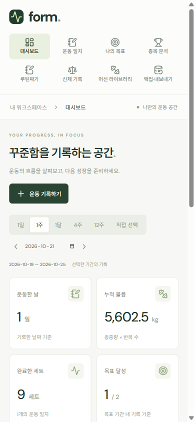
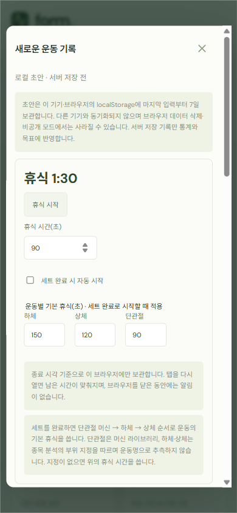
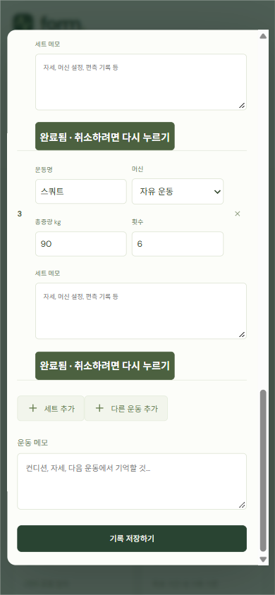
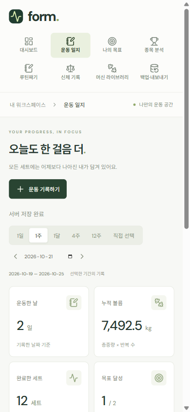
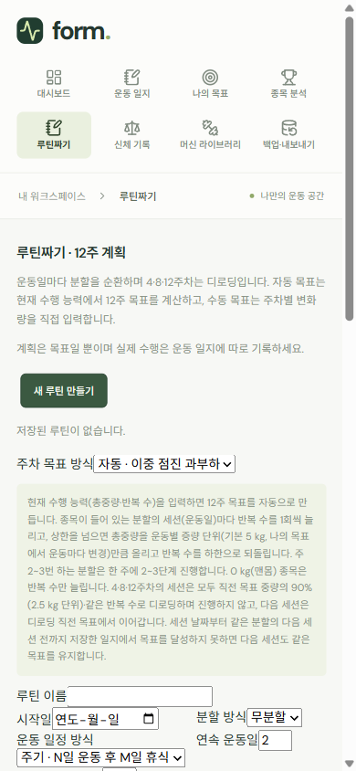
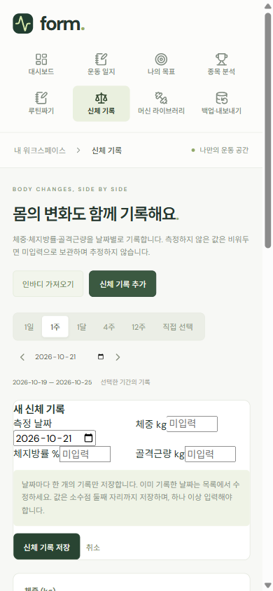
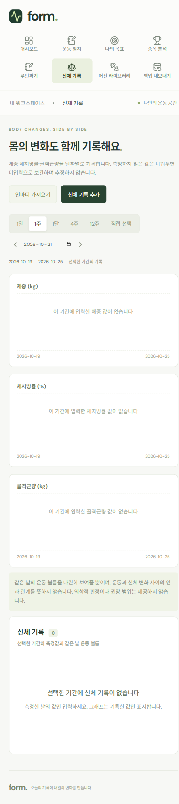
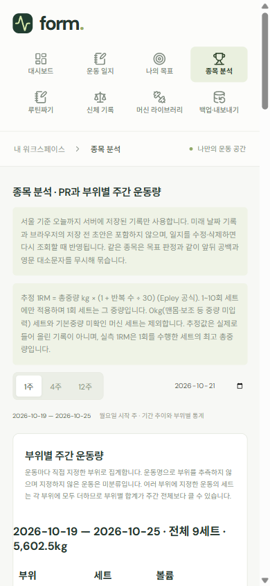
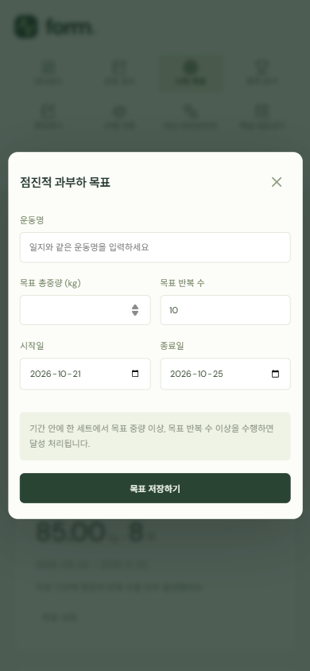
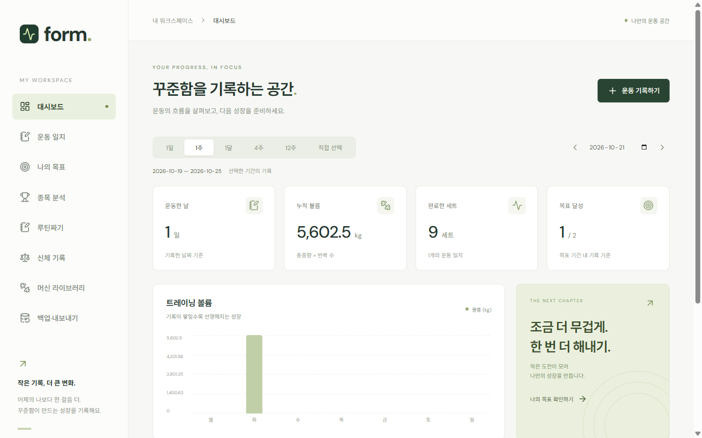

# UI/UX 점검 — 2026-10-21

[#112](https://github.com/sirloinbh/workout-memo/issues/112) 결과다. 앱은 주로 휴대폰으로 쓰고 가끔 PC로 본다. 그래서 390px 화면을 기준으로 과업 시나리오를 수행하고, 1280px 화면은 비교용으로 찍었다. 개선점은 [UI 기준 선정 #98](https://github.com/sirloinbh/workout-memo/issues/98)과 [모바일 입력 흐름 #105](https://github.com/sirloinbh/workout-memo/issues/105) 등 후속 이슈에 연결했다.

## 방법

- 대상: `origin/main` `2058660`(#97 병합 시점). 개인 DB는 쓰지 않았다.
  - 로컬 전용 테스트 DB 컨테이너에 점검용 DB `workout_ux_audit`을 새로 만들었다.
  - `npm run db:migrate`로 스키마를 적용했다.
  - API(3101)와 Vite(5174)를 e2e와 같은 방식으로 띄웠다.
- 데이터: API로 시드를 넣었다.
  - 최근 4주 일지 12개: 하체·가슴·등 3분할, 운동 9종, 세트 108개
  - 목표 2개, 신체 기록 4개(주 1회), 머신 1개
  - 시나리오 1에서 화면으로 일지 1개를 추가했다.
- 도구: Playwright(설치된 Chrome)
  - 화면 크기: 390×844, 1280×800
  - 페이지마다 다음을 측정했다.
    - 가로 넘침(`scrollWidth`)
    - 44px 미만 터치 대상
    - 16px 미만 입력 글자
    - 13px 미만 텍스트
    - 페이지·모달 세로 길이
- 평가 기준: 휴리스틱(닐슨 10원칙)
  - 모바일 터치 대상 44px, 입력 글자 16px 이상(iOS 확대 방지)
  - 첫 화면에서 주요 행동이 보이는지
  - 빈 상태·저장 결과 표시
- 하지 못한 것
  - 실제 휴대폰 테스트
  - Lighthouse 모바일: DevTools MCP의 Lighthouse 실행이 30분 동안 응답하지 않아 중단했다.
  - 두 항목은 [다시 측정](#다시-측정) 절차로 이어서 한다.

## 페이지별 측정(390px)

| 페이지           | 세로 길이(px) | 조작 요소 | 44px 미만 | 16px 미만 입력 | 13px 미만 텍스트 |
| ---------------- | ------------: | --------: | --------: | -------------: | ---------------: |
| 대시보드         |         1,722 |        23 |        15 |            1/1 |               63 |
| 운동 일지        |         1,388 |        21 |        13 |            1/1 |               47 |
| 나의 목표        |         1,129 |        12 |         4 |              — |               27 |
| 종목 분석        |     **4,462** |        22 |        14 |            1/1 |               49 |
| 루틴짜기         |           844 |        10 |         2 |              — |               16 |
| 신체 기록        |         1,677 |        20 |        12 |            1/1 |               40 |
| 머신 라이브러리  |           844 |        17 |         9 |              — |               25 |
| 백업·내보내기    |         1,235 |        13 |         5 |            2/2 |               20 |
| 새 일지 모달     |     **2,393** |        38 |        13 |          23/23 |                — |
| 일지 수정(9세트) |     **4,343** |         — |         — |              — |                — |

- 가로 넘침은 없었다(#71 수정 유지). `scrollWidth`가 390보다 작은 375인 페이지는 세로 스크롤바 폭(15px) 때문이다.
- 44px 미만 터치 대상 예
  - 기간 탭(1일·1주…) 38×30
  - 세트 삭제 26×29. `완료` 버튼 바로 옆에 있다.
  - 체감 피드백 44×30
  - 목표 삭제 59×32
  - 자동 시작 체크박스 13×13
- 일지 편집 모달의 입력 글자는 9~12px다. 세트 메모가 9px, 운동명·중량·횟수가 12px다.

## 과업 시나리오(390px)

| #   | 과업                                | 결과                                                                                                                                                        |
| --- | ----------------------------------- | ----------------------------------------------------------------------------------------------------------------------------------------------------------- |
| 1   | 새 일지 → 세트 3개 입력·완료 → 저장 | 성공. 입력·탭 14회(제목 1, 세트별 운동명·중량·횟수 9, 완료 3, 저장 1), 모달 3.1화면 분량 스크롤. 날짜 y=839, 첫 세트 y=1,236, 저장 y=2,377(보이는 높이 760) |
| 2   | 3주 전 기록 찾아 수정               | 성공. 기본 기간이 1주라 `4주`로 바꿔야 함(1탭). 목록 페이지 2,958px. 9세트 일지 수정 모달은 4,343px(5.7화면)                                                |
| 3   | 목표 확인과 새 목표 추가            | 성공. 모달이 한 화면에 들어옴. 종료일 기본값이 이번 주 일요일(4일 뒤). 운동명은 직접 입력해야 함                                                            |
| 4   | 새 루틴 만들기                      | 폼은 열리지만 디자인 시스템 밖의 기본 컨트롤로 표시됨(아래 U-04). 페이지 2,030px. 입력 전에 설명문 9줄. 시작일 빈 값                                        |
| 5   | 신체 기록 추가, 인바디 가져오기     | 둘 다 페이지 안 인라인 폼으로 열리고 기본 컨트롤로 표시됨. 두 폼이 동시에 열려 쌓임. Escape로 닫히지 않음. 기본 기간 1주라 지난주 측정값이 안 보임          |
| 6   | 종목 분석에서 PR·추이 확인          | 운동 9종 카드가 모두 펼쳐져 4,462px. 부위별 주간 운동량 표는 대부분 `0세트 0kg`                                                                             |

## 개선점

심각도: P1 = 주요 과업을 크게 방해, P2 = 불편·오조작 위험, P3 = 다듬기.

| ID   | 심각도 | 문제                                                                                                                                                                      | 근거                                      | 개선안                                                                                                        | 연결                                                                                                                                                                                     |
| ---- | ------ | ------------------------------------------------------------------------------------------------------------------------------------------------------------------------- | ----------------------------------------- | ------------------------------------------------------------------------------------------------------------- | ---------------------------------------------------------------------------------------------------------------------------------------------------------------------------------------- |
| U-01 | P1     | 일지 편집기 첫 화면에 입력란이 없다. 로컬 초안 안내문, 휴식 타이머, 운동별 기본 휴식 설정, 안내문 2개가 먼저 나온다.                                                      | 날짜 y=839, 첫 세트 y=1,236. 시나리오 1·2 | 날짜·제목·세트를 맨 위로 올린다. 휴식 설정은 접거나 설정 화면으로 옮긴다. 안내문은 한 줄이나 도움말로 줄인다. | [#105](https://github.com/sirloinbh/workout-memo/issues/105)                                                                                                                             |
| U-02 | P1     | 세트마다 운동명·머신·메모(80px)가 반복되어 세트 1개가 약 300px다. 같은 운동이 세트 수만큼 반복된다.                                                                       | 3세트 모달 2,393px, 9세트 4,343px         | 운동 단위로 묶고 세트는 한 줄(중량·횟수·완료)로 표시한다. 메모는 필요할 때 펼친다.                            | [#105](https://github.com/sirloinbh/workout-memo/issues/105)                                                                                                                             |
| U-03 | P1     | 휴식 타이머가 모달 맨 위에만 있다. 아래쪽 세트에서 `완료`를 누르면 타이머가 시작되지만 화면에 보이지 않는다.                                                              | 완료 후 화면(스크린샷 3)                  | 타이머를 화면 위 또는 아래에 고정해 항상 보이게 한다.                                                         | [#105](https://github.com/sirloinbh/workout-memo/issues/105)                                                                                                                             |
| U-04 | P1     | 루틴짜기·신체 기록·인바디 폼이 공통 컴포넌트와 스타일 없이 브라우저 기본 입력·선택상자로 표시된다. 라벨과 입력란이 붙어 있고 "현재 총중량"처럼 라벨이 줄 중간에서 끊긴다. | 스크린샷 5·6                              | 공통 `Field`·`Select`·`Button`으로 교체한다. 루틴은 단계별 입력으로 나눈다.                                   | [#102](https://github.com/sirloinbh/workout-memo/issues/102), [#103](https://github.com/sirloinbh/workout-memo/issues/103), [#105](https://github.com/sirloinbh/workout-memo/issues/105) |
| U-05 | P1     | 첫 화면의 약 46%가 화면 공통 영역이다. 메뉴 8개 2줄(약 190px), 경로 표시, 영문 머리말·구호·설명이 차지한다. 주요 버튼 `운동 기록하기`는 y≈387에 있다.                     | 대시보드·일지 스크린샷                    | 모바일은 하단 탭(4~5개 + 더보기)으로 바꾼다. 페이지 머리는 제목 한 줄과 주요 버튼만 남긴다.                   | [#104](https://github.com/sirloinbh/workout-memo/issues/104)                                                                                                                             |
| U-06 | P2     | 터치 대상이 작고 위험한 버튼이 가깝다. 세트 삭제(26×29)가 `완료` 바로 옆에 있다. 기간 탭·체감 버튼은 높이 30px다.                                                         | 페이지별 측정                             | 최소 44px로 맞춘다. 삭제는 메뉴나 밀기 동작으로 옮기거나 되돌리기를 제공한다.                                 | [#99](https://github.com/sirloinbh/workout-memo/issues/99), [#104](https://github.com/sirloinbh/workout-memo/issues/104)                                                                 |
| U-07 | P2     | 글자가 작다. 입력 9~12px, 페이지마다 13px 미만 텍스트가 16~63개다. iOS는 16px 미만 입력란에 포커스하면 화면을 확대한다.                                                   | 페이지별 측정                             | 본문 15~16px, 입력 16px, 보조 13px 이상을 디자인 기준으로 정한다.                                             | [#98](https://github.com/sirloinbh/workout-memo/issues/98)                                                                                                                               |
| U-08 | P2     | 저장 결과가 잘 보이지 않는다. 저장하면 `서버 저장 완료` 작은 글자만 버튼 아래에 나오고, 방금 저장한 기록은 첫 화면 밖 목록에 있다.                                        | 저장 후 화면(스크린샷 4)                  | Toast로 알리고, 저장한 기록으로 이동하거나 강조한다.                                                          | [#99](https://github.com/sirloinbh/workout-memo/issues/99), [#101](https://github.com/sirloinbh/workout-memo/issues/101)                                                                 |
| U-09 | P2     | 신체 기록의 기본 기간이 1주다. 주 1회 측정하면 첫 화면이 빈 그래프 3개다.                                                                                                 | 시나리오 5, 스크린샷 7                    | 기본 기간을 12주 또는 마지막 기록 기준으로 한다.                                                              | [#123](https://github.com/sirloinbh/workout-memo/issues/123)                                                                                                                             |
| U-10 | P2     | 운동명을 매번 직접 입력한다(새 일지 3세트에 3번). 이름이 조금 다르면 목표·분석에서 다른 운동이 된다.                                                                      | 시나리오 1·3                              | 최근·자주 쓴 운동 자동완성, 비슷한 이름 제안                                                                  | [#124](https://github.com/sirloinbh/workout-memo/issues/124)                                                                                                                             |
| U-11 | P2     | 종목 분석이 4,462px다. 9종목 상세가 모두 펼쳐져 있고 부위 표는 대부분 0이다.                                                                                              | 시나리오 6                                | 요약 목록 → 종목 상세, 빈 부위 접기                                                                           | [#125](https://github.com/sirloinbh/workout-memo/issues/125)                                                                                                                             |
| U-12 | P2     | 대시보드와 운동 일지 상단이 같다(통계 카드 4개·기간 선택). 화면 역할이 구분되지 않는다. 대시보드의 `THE NEXT CHAPTER` 카드(약 210px)는 장식이다.                          | 대시보드·일지 스크린샷                    | 대시보드는 오늘 루틴·이번 주 요약, 일지는 기록 목록 중심으로 나눈다. 장식 카드는 뺀다.                        | [#101](https://github.com/sirloinbh/workout-memo/issues/101)                                                                                                                             |
| U-13 | P3     | 숫자 표시가 어색하다. 그래프 축 눈금이 `4,201.88`·`1,400.63`이고 목표 중량이 `85.00 kg`이다.                                                                              | 대시보드·목표 스크린샷                    | 축은 보기 좋은 단위로 반올림하고, 중량은 불필요한 소수 0을 뺀다.                                              | [#101](https://github.com/sirloinbh/workout-memo/issues/101), [#102](https://github.com/sirloinbh/workout-memo/issues/102)                                                               |
| U-14 | P3     | 기본값이 과업과 맞지 않는다. 목표 종료일이 이번 주 일요일(4일 뒤)이고, 루틴 시작일은 비어 있다.                                                                           | 시나리오 3·4                              | 목표 종료일은 4~12주 뒤, 루틴 시작일은 오늘 또는 다음 월요일                                                  | [#102](https://github.com/sirloinbh/workout-memo/issues/102)                                                                                                                             |
| U-15 | P3     | 인라인 폼(신체 기록·인바디)이 동시에 열려 쌓이고 Escape로 닫히지 않는다. 모달(일지·목표·머신)과 동작이 다르다.                                                            | 시나리오 5                                | 입력 폼은 모바일 하단 시트 또는 모달 하나로 통일한다.                                                         | [#99](https://github.com/sirloinbh/workout-memo/issues/99), [#103](https://github.com/sirloinbh/workout-memo/issues/103)                                                                 |
| U-16 | P3     | `favicon.ico`가 404다. 홈 화면 아이콘도 없다.                                                                                                                             | 브라우저 콘솔                             | PWA 아이콘과 함께 추가한다.                                                                                   | [#109](https://github.com/sirloinbh/workout-memo/issues/109)                                                                                                                             |

1280px에서는 사이드바·4열 통계 카드가 정상적으로 배치된다. 데스크톱 고유의 P1 문제는 없었다. U-07·U-12·U-13은 데스크톱에도 해당한다.

## 스크린샷(390px, 1280px 1장)

1. 대시보드 첫 화면: 
2. 새 일지 모달 첫 화면(U-01): 
3. 세트 완료 후. 타이머가 보이지 않는다(U-02·U-03): 
4. 저장 후 운동 일지(U-08): 
5. 새 루틴 폼(U-04): 
6. 신체 기록 추가 폼(U-04): 
7. 신체 기록 전체, 기본 1주(U-09): 
8. 종목 분석 첫 화면(U-11): 
9. 목표 추가 모달(U-14): 
10. 대시보드 1280px: 

## 반영 순서

1. #98 UI 기준 선정에 U-05·U-06·U-07·U-15의 기준을 넣는다.
   - 하단 탭
   - 터치 44px
   - 글자 크기
   - 입력 폼 형태(하단 시트)
2. #105에서 U-01·U-02·U-03을 해결한다. 운동 중 기록이 가장 자주 쓰는 과업이다.
3. #123은 화면 교체와 상관없이 먼저 고칠 수 있다(작은 수정).

## 다시 측정

UI 교체(#101~#105) 후 같은 조건으로 다시 측정하고, 이 문서와 비교하는 새 날짜 문서를 만든다.

1. 테스트 DB 컨테이너에 점검용 DB를 만들고 `npm run db:migrate`를 실행한다. 개인 DB는 쓰지 않는다.
2. `DATABASE_URL`=점검용 DB, `PORT=3101`로 `tsx backend/src/server.ts`를 실행한다.
3. `API_PROXY_TARGET=http://127.0.0.1:3101`로 `npm run dev -w frontend -- --port 5174`를 실행한다.
4. 위 시드 구성(4주 일지 12개, 목표 2개, 신체 기록 4개)을 API로 넣는다.
5. 390×844에서 6개 시나리오를 수행하고 같은 지표를 측정한다.
6. 실제 안드로이드 휴대폰에서 시나리오 1·2를 수행하고 기종·브라우저를 적는다. 운영 서버는 IP 제한이 있어서 허용 IP의 와이파이에서 접속한다.
7. Chrome DevTools Lighthouse(모바일)로 접근성·권장사항 점수를 기록한다.
