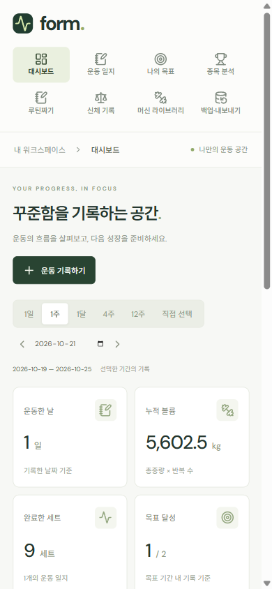
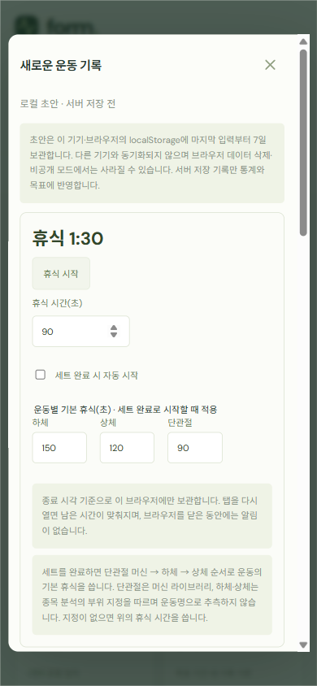
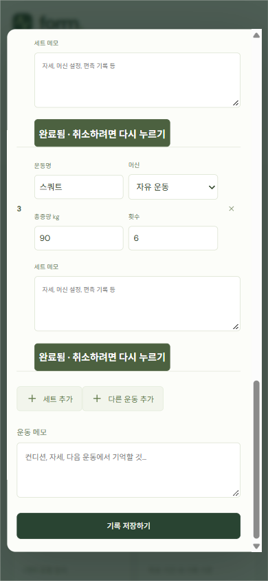
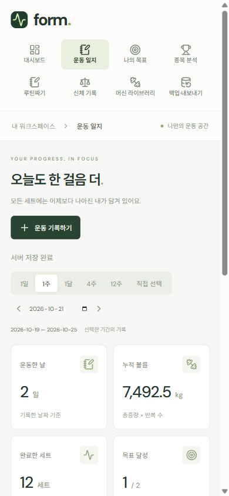
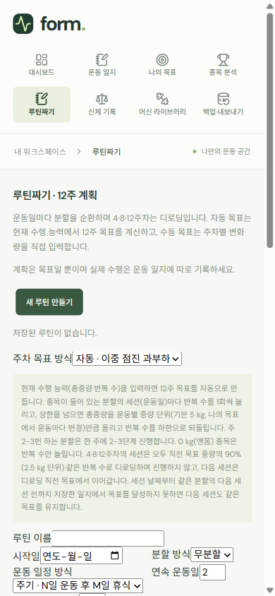
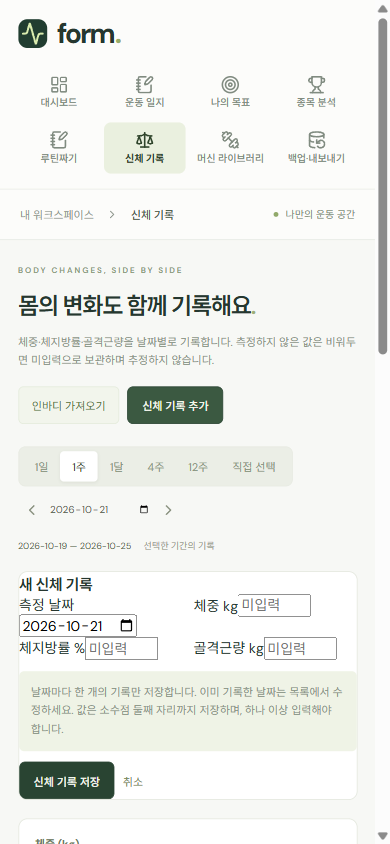
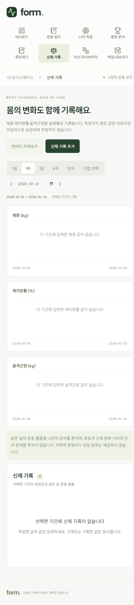
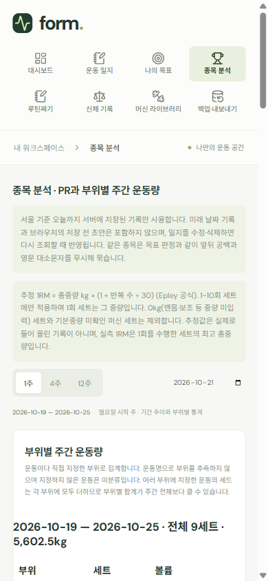
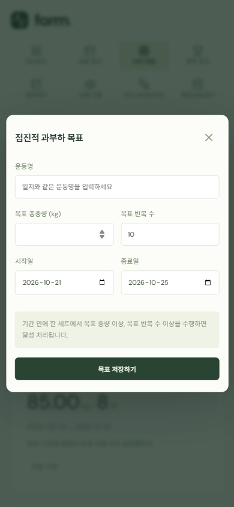
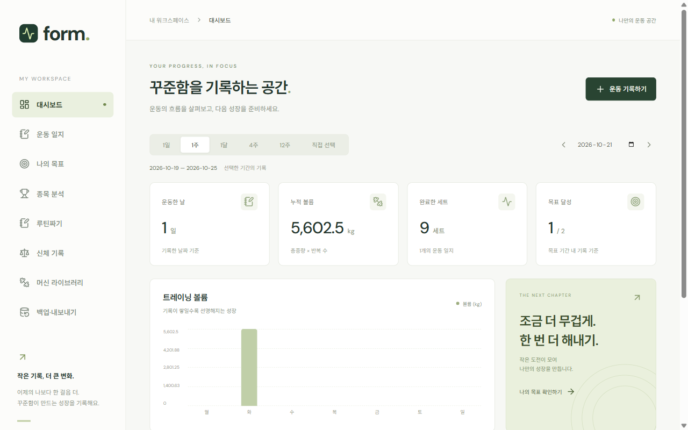

# UI/UX audit — 2026-10-21

This is the result of [#112](https://github.com/sirloinbh/workout-memo/issues/112). The app is used mainly on a phone and only occasionally on a PC. So we ran the task scenarios on a 390px screen and took 1280px screenshots for comparison. The improvements are linked to follow-up issues such as [choosing the UI standard #98](https://github.com/sirloinbh/workout-memo/issues/98) and [mobile input flow #105](https://github.com/sirloinbh/workout-memo/issues/105).

## Method

- Target: `origin/main` `2058660` (when #97 was merged). The personal DB was not used.
  - We created a new audit DB, `workout_ux_audit`, in a local-only test DB container.
  - We applied the schema with `npm run db:migrate`.
  - We started the API (3101) and Vite (5174) the same way as e2e.
- Data: we seeded it through the API.
  - 12 logs over the last 4 weeks: a 3-way split of lower body, chest and back; 9 exercises; 108 sets
  - 2 goals, 4 body records (once a week), 1 machine
  - In scenario 1 we added one more log through the screen.
- Tool: Playwright (installed Chrome)
  - Screen sizes: 390×844, 1280×800
  - For each page we measured the following.
    - Horizontal overflow (`scrollWidth`)
    - Touch targets under 44px
    - Input text under 16px
    - Text under 13px
    - Page and modal height
- Criteria: heuristics (Nielsen's 10 principles)
  - Mobile touch targets of 44px, input text of 16px or more (to prevent iOS zoom)
  - Whether the main action is visible on the first screen
  - Empty states and how the save result is shown
- What we could not do
  - Testing on a real phone
  - Lighthouse mobile: the Lighthouse run in the DevTools MCP did not respond for 30 minutes, so we stopped it.
  - We continue both items with the [re-measuring](#re-measuring) procedure.

## Per-page measurements (390px)

The Korean page names are the screen names in the app (Dashboard, Workout log, My goals, Exercise analysis, Routine builder, Body records, Machine library, Backup and export, New log modal, Edit log (9 sets)).

| Page                                | Height (px) | Interactive elements | Under 44px | Inputs under 16px | Text under 13px |
| ----------------------------------- | ----------: | -------------------: | ---------: | ----------------: | --------------: |
| 대시보드 (Dashboard)                |       1,722 |                   23 |         15 |               1/1 |              63 |
| 운동 일지 (Workout log)             |       1,388 |                   21 |         13 |               1/1 |              47 |
| 나의 목표 (My goals)                |       1,129 |                   12 |          4 |                 — |              27 |
| 종목 분석 (Exercise analysis)       |   **4,462** |                   22 |         14 |               1/1 |              49 |
| 루틴짜기 (Routine builder)          |         844 |                   10 |          2 |                 — |              16 |
| 신체 기록 (Body records)            |       1,677 |                   20 |         12 |               1/1 |              40 |
| 머신 라이브러리 (Machine library)   |         844 |                   17 |          9 |                 — |              25 |
| 백업·내보내기 (Backup and export)   |       1,235 |                   13 |          5 |               2/2 |              20 |
| 새 일지 모달 (New log modal)        |   **2,393** |                   38 |         13 |             23/23 |               — |
| 일지 수정(9세트) (Edit log, 9 sets) |   **4,343** |                    — |          — |                 — |               — |

- There was no horizontal overflow (the #71 fix holds). A `scrollWidth` of 375 instead of 390 on some pages is because of the width of the vertical scrollbar (15px).
- Examples of touch targets under 44px
  - Period tabs (1일, 1주, and so on; 1 day, 1 week) 38×30
  - Set delete 26×29. It sits right next to the `완료` (Done) button.
  - Perceived-effort feedback 44×30
  - Goal delete 59×32
  - Auto-start checkbox 13×13
- The input text in the log edit modal is 9 to 12px. The set memo is 9px, and the exercise name, weight and reps are 12px.

## Task scenarios (390px)

| #   | Task                                          | Result                                                                                                                                                                                                                     |
| --- | --------------------------------------------- | -------------------------------------------------------------------------------------------------------------------------------------------------------------------------------------------------------------------------- |
| 1   | New log → enter and complete 3 sets → save    | Succeeded. 14 inputs and taps (title 1, exercise name, weight and reps per set 9, done 3, save 1) and 3.1 screens of scrolling in the modal. Date at y=839, first set at y=1,236, save at y=2,377 (visible height 760)     |
| 2   | Find and edit a record from 3 weeks ago       | Succeeded. The default period is 1 week, so you must switch to `4주` (4 weeks) (1 tap). The list page is 2,958px. The edit modal of a 9-set log is 4,343px (5.7 screens)                                                   |
| 3   | Check goals and add a new goal                | Succeeded. The modal fits on one screen. The default end date is this week's Sunday (4 days away). You must type the exercise name yourself                                                                                |
| 4   | Create a new routine                          | The form opens but shows default controls outside the design system (U-04 below). The page is 2,030px. There are 9 lines of explanation before you can type. The start date is empty                                       |
| 5   | Add a body record, import from InBody         | Both open as inline forms inside the page and show default controls. The two forms open at the same time and stack up. Escape does not close them. The default period is 1 week, so last week's measurement is not visible |
| 6   | Check PRs and trends in the exercise analysis | All 9 exercise cards are expanded, so the page is 4,462px. Most of the per-body-part weekly volume table is `0세트 0kg` (0 sets 0 kg)                                                                                      |

## Improvements

Severity: P1 = seriously blocks a main task, P2 = inconvenient or risks mistakes, P3 = polish.

| ID   | Severity | Problem                                                                                                                                                                                                                                                   | Evidence                                               | Proposal                                                                                                                                               | Link                                                                                                                                                                                     |
| ---- | -------- | --------------------------------------------------------------------------------------------------------------------------------------------------------------------------------------------------------------------------------------------------------- | ------------------------------------------------------ | ------------------------------------------------------------------------------------------------------------------------------------------------------ | ---------------------------------------------------------------------------------------------------------------------------------------------------------------------------------------- |
| U-01 | P1       | The first screen of the log editor has no input field. The local draft notice, the rest timer, the per-exercise default rest setting and 2 notices come first.                                                                                            | Date at y=839, first set at y=1,236. Scenarios 1 and 2 | Move the date, title and sets to the top. Fold the rest settings or move them to the settings screen. Shorten the notices to one line or to help text. | [#105](https://github.com/sirloinbh/workout-memo/issues/105)                                                                                                                             |
| U-02 | P1       | Every set repeats the exercise name, machine and memo (80px), so one set is about 300px. The same exercise repeats as many times as there are sets.                                                                                                       | 3-set modal 2,393px, 9-set modal 4,343px               | Group by exercise and show each set in one line (weight, reps, done). Expand the memo only when needed.                                                | [#105](https://github.com/sirloinbh/workout-memo/issues/105)                                                                                                                             |
| U-03 | P1       | The rest timer is only at the very top of the modal. When you press `완료` (Done) on a set lower down, the timer starts but is not visible on the screen.                                                                                                 | Screen after Done (screenshot 3)                       | Pin the timer to the top or bottom of the screen so it is always visible.                                                                              | [#105](https://github.com/sirloinbh/workout-memo/issues/105)                                                                                                                             |
| U-04 | P1       | The routine builder, body record and InBody forms show the browser's default inputs and select boxes, with no shared components or styles. Labels sit tight against the inputs, and a label such as "현재 총중량" (current total weight) breaks mid-line. | Screenshots 5 and 6                                    | Replace them with the shared `Field`, `Select` and `Button`. Split the routine into step-by-step input.                                                | [#102](https://github.com/sirloinbh/workout-memo/issues/102), [#103](https://github.com/sirloinbh/workout-memo/issues/103), [#105](https://github.com/sirloinbh/workout-memo/issues/105) |
| U-05 | P1       | About 46% of the first screen is shared screen chrome: 8 menu items in 2 lines (about 190px), the path display, and the English heading, slogan and description. The main button `운동 기록하기` (Log a workout) is at y≈387.                             | Dashboard and log screenshots                          | On mobile, switch to a bottom tab bar (4 to 5 tabs + More). Leave only a one-line title and the main button in the page header.                        | [#104](https://github.com/sirloinbh/workout-memo/issues/104)                                                                                                                             |
| U-06 | P2       | Touch targets are small and risky buttons are close together. Set delete (26×29) is right next to `완료` (Done). The period tabs and the perceived-effort buttons are 30px high.                                                                          | Per-page measurements                                  | Make them at least 44px. Move delete to a menu or a swipe action, or offer undo.                                                                       | [#99](https://github.com/sirloinbh/workout-memo/issues/99), [#104](https://github.com/sirloinbh/workout-memo/issues/104)                                                                 |
| U-07 | P2       | The text is small. Inputs are 9 to 12px, and each page has 16 to 63 text items under 13px. iOS zooms the screen when you focus an input under 16px.                                                                                                       | Per-page measurements                                  | Set the design standard to 15 to 16px for body text, 16px for inputs and at least 13px for secondary text.                                             | [#98](https://github.com/sirloinbh/workout-memo/issues/98)                                                                                                                               |
| U-08 | P2       | The save result is hard to see. After saving, only the small text `서버 저장 완료` (Saved to the server) appears under the button, and the record you just saved is in the list outside the first screen.                                                 | Screen after save (screenshot 4)                       | Notify with a toast, and navigate to or highlight the saved record.                                                                                    | [#99](https://github.com/sirloinbh/workout-memo/issues/99), [#101](https://github.com/sirloinbh/workout-memo/issues/101)                                                                 |
| U-09 | P2       | The default period of the body records is 1 week. If you measure once a week, the first screen is 3 empty graphs.                                                                                                                                         | Scenario 5, screenshot 7                               | Make the default period 12 weeks, or base it on the last record.                                                                                       | [#123](https://github.com/sirloinbh/workout-memo/issues/123)                                                                                                                             |
| U-10 | P2       | You type the exercise name every time (3 times for the 3 sets of a new log). If a name differs slightly, it becomes a different exercise in goals and analysis.                                                                                           | Scenarios 1 and 3                                      | Autocomplete from recent and frequent exercises, and suggest similar names                                                                             | [#124](https://github.com/sirloinbh/workout-memo/issues/124)                                                                                                                             |
| U-11 | P2       | The exercise analysis is 4,462px. All 9 exercise details are expanded and most of the body-part table is 0.                                                                                                                                               | Scenario 6                                             | Summary list → exercise detail, and fold empty body parts                                                                                              | [#125](https://github.com/sirloinbh/workout-memo/issues/125)                                                                                                                             |
| U-12 | P2       | The top of the dashboard and the workout log are the same (4 stat cards and a period selector). The roles of the screens are not distinct. The `THE NEXT CHAPTER` card (about 210px) on the dashboard is decoration.                                      | Dashboard and log screenshots                          | Make the dashboard about today's routine and this week's summary, and the log about the record list. Remove the decorative card.                       | [#101](https://github.com/sirloinbh/workout-memo/issues/101)                                                                                                                             |
| U-13 | P3       | Number display is awkward. The graph axis ticks are `4,201.88` and `1,400.63`, and a goal weight is `85.00 kg`.                                                                                                                                           | Dashboard and goal screenshots                         | Round the axis to a readable step, and drop unnecessary decimal zeros from weights.                                                                    | [#101](https://github.com/sirloinbh/workout-memo/issues/101), [#102](https://github.com/sirloinbh/workout-memo/issues/102)                                                               |
| U-14 | P3       | The defaults do not match the task. The goal end date is this week's Sunday (4 days away), and the routine start date is empty.                                                                                                                           | Scenarios 3 and 4                                      | Goal end date 4 to 12 weeks later, routine start date today or next Monday                                                                             | [#102](https://github.com/sirloinbh/workout-memo/issues/102)                                                                                                                             |
| U-15 | P3       | Inline forms (body record, InBody) open at the same time and stack up, and Escape does not close them. They behave differently from the modals (log, goal, machine).                                                                                      | Scenario 5                                             | Unify input forms into a mobile bottom sheet or a single modal.                                                                                        | [#99](https://github.com/sirloinbh/workout-memo/issues/99), [#103](https://github.com/sirloinbh/workout-memo/issues/103)                                                                 |
| U-16 | P3       | `favicon.ico` returns 404. There is no home screen icon either.                                                                                                                                                                                           | Browser console                                        | Add it together with the PWA icons.                                                                                                                    | [#109](https://github.com/sirloinbh/workout-memo/issues/109)                                                                                                                             |

At 1280px the sidebar and the 4-column stat cards lay out correctly. There was no P1 problem specific to desktop. U-07, U-12 and U-13 also apply to desktop.

## Screenshots (390px, one at 1280px)

1. Dashboard first screen: 
2. New log modal first screen (U-01): 
3. After completing a set. The timer is not visible (U-02, U-03): 
4. Workout log after saving (U-08): 
5. New routine form (U-04): 
6. Add body record form (U-04): 
7. Whole body records page, default 1 week (U-09): 
8. Exercise analysis first screen (U-11): 
9. Add goal modal (U-14): 
10. Dashboard at 1280px: 

## Order of changes

1. Put the standards for U-05, U-06, U-07 and U-15 into #98, choosing the UI standard.
   - Bottom tabs
   - 44px touch targets
   - Font size
   - Input form shape (bottom sheet)
2. Fix U-01, U-02 and U-03 in #105. Recording during a workout is the most frequently used task.
3. #123 can be fixed first, regardless of the screen replacement (a small fix).

## Re-measuring

After the UI replacement (#101 to #105), measure again under the same conditions and create a new dated document that compares with this one.

1. Create an audit DB in the test DB container and run `npm run db:migrate`. Do not use the personal DB.
2. Run `tsx backend/src/server.ts` with `DATABASE_URL` set to the audit DB and `PORT=3101`.
3. Run `npm run dev -w frontend -- --port 5174` with `API_PROXY_TARGET=http://127.0.0.1:3101`.
4. Insert the seed set above (12 logs over 4 weeks, 2 goals, 4 body records) through the API.
5. Run the 6 scenarios at 390×844 and measure the same metrics.
6. Run scenarios 1 and 2 on a real Android phone and write down the device and browser. The production server has an IP restriction, so connect from Wi-Fi on an allowed IP.
7. Record the accessibility and best-practices scores with Chrome DevTools Lighthouse (mobile).
